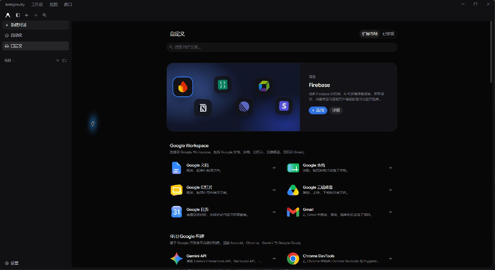

# Antigravity 简体中文补丁

适用于 Windows 版 **Google Antigravity App 2.33.0、2.34.0、2.35.0 和 2.35.1**。补丁覆盖菜单、设置、首次使用引导和对话控件。2.35 系列补齐了对话时间、模型档位、新建自动化表单、扩展市场及组合读写权限提示。第三方插件动态提供的部分内容可能仍显示英文。

本仓库提供补丁源码和词库。工具按 SHA-256 识别安装版本，并使用本机的官方 `app.asar` 生成汉化文件。补丁只处理界面文案，AI 回复语言由对话和模型设置决定。

## 实机截图



## 安装

1. 确认已安装上述版本之一的 Windows 版 Antigravity App，以及 Node.js 20 或更新版本。
2. 下载或克隆仓库，在 PowerShell 中进入 `antigravity-zh-cn` 目录，检查当前安装状态。 [GitHub 仓库](https://github.com/TOM1457998914/antigravity-zh-cn)

   ```powershell
   node .\localize.mjs status
   ```

3. 保存工作并通过 Windows 系统托盘彻底退出 Antigravity，然后运行安装命令。安装成功后，重新打开 Antigravity。

   ```powershell
   node .\localize.mjs apply
   ```

默认安装目录为 `%LOCALAPPDATA%\Programs\antigravity`。如果装在其他位置，用 `--app-dir` 指定含有 `resources` 子目录的应用安装目录。

```powershell
node .\localize.mjs status --app-dir 'D:\Apps\Antigravity'
node .\localize.mjs apply --app-dir 'D:\Apps\Antigravity'
```

## 恢复英文界面

通过系统托盘彻底退出 Antigravity，再运行以下命令。若安装时指定了 `--app-dir`，恢复时也指定同一目录。

```powershell
node .\localize.mjs restore
```

安装补丁前，工具会在 `resources\app.asar.zh-cn.original` 创建或验证原版备份。如果该文件已被另一份备份占用，工具会保留它，并使用 `resources\app.asar.zh-cn.original.<版本>` 存放当前版本的原版。工具以 SHA-256 验证原版、备份和生成的汉化归档。`status` 会显示当前归档的 SHA-256 和可用的原版备份。

应用更新后可先运行 `status` 检查状态。若出现「不支持的版本或未知改动」，请使用对应版本的补丁，或从 Google 下载官方安装程序修复。 [Antigravity 官方下载](https://antigravity.google/download)

## 单独生成汉化文件

`build` 默认读取受支持版本的本机原始归档或已校验的原版备份，并在当前目录生成 `app.asar.zh-cn`。也可以用 `--input` 指定原版归档，用 `--output` 指定一个单独的输出路径。

```powershell
node .\localize.mjs build
node .\localize.mjs build --input 'D:\Backups\app.asar' --output '.\app.asar.zh-cn'
```

## 运行测试

使用 Node.js 20 或更新版本，在仓库目录运行以下命令。

```powershell
npm test
```

也可以直接运行 `node --test`。测试使用临时目录和合成归档，涵盖版本识别、未知 SHA-256 拒绝以及备份和还原。安装和还原用例在 Windows 上运行。

## 来源和许可

这是社区维护的界面补丁，在 `antigravity-cn-community/Antigravity-Chinese-Localization` 的 v2.33.0、v2.34.0 和 v2.35.0 基础上整理，并保留 aabbWei 和 antigravity-cn-community contributors 的版权声明。2.35.1 适配以对应版本的官方归档为输入。补丁源码采用 MIT 许可证。 [上游 v2.33.0](https://github.com/antigravity-cn-community/Antigravity-Chinese-Localization/releases/tag/v2.33.0) · [上游 v2.34.0](https://github.com/antigravity-cn-community/Antigravity-Chinese-Localization/releases/tag/v2.34.0) · [上游 v2.35.0](https://github.com/antigravity-cn-community/Antigravity-Chinese-Localization/releases/tag/v2.35.0) · [MIT 许可证](LICENSE)

